Грицай Иван 4541в
# Лабораторная работа №6
# Система контроля версий


## Цель лабораторной работы:
 изучение базовых возможностей системы управления версиями, опыт работы с Git Api, опыт работы с локальным  и удаленным репозиторием.
## Порядок выполнения работы:
1. Создать аккаунт на сайте GitHub.
2. Сделать копию в личное хранилище из
https://github.com/Kurtyanik/LR6/ (Fork).
3. Установить Git (https://git-scm.com/).
4. После установки настроить клиент git, введя имя пользователя (Группа
Фамилия И.О.) и email.
5. Клонировать свой личный удалённый репозиторий на компьютер.
6. Добавить файл через интерфейс GitHub. Подтянуть изменения в
локальный репозиторий.
Работу продолжать локально.
7. Получить историю операций для каждой из веток.
8. Просмотреть последние изменения.
9. Выполнить слияние в ветку master, разрешив конфликт (можно
использовать специальные редакторы или графический интерфейс git).
10. Удалить побочную ветку после успешного слияния.
11. Сделать изменения и зафиксировать их, оставляя комментарии,
несколько раз.
12. Сделать откат коммита.
13. Создать ветку для отчёта.
14. Начать оформлять отчёт в файле README.md (разрешены сторонние
редакторы с подсветкой синтаксиса), используя markdown синтаксис
(https://guides.github.com/features/mastering-markdown/):
+   В отчёте должен быть снимки экрана консоли и сторонних программ.
Файлы снимков экрана разместить в отдельной папке.
+   Лог команд (без результатов их выполнения).
При написании отчёта периодически делать коммиты, не забывать
комментировать.
15. Получить историю операций в форматированном виде (сокращённый
хэш + дата + имя автора + комментарий). Добавить её в отчёт и сделать
финальную фиксацию изменений.
16. Отправить локальные изменения в сетевое хранилище GitHub (если
делаете работу постепенно, то синхронизацию проводить в конце рабочего
сеанса)

## Выполнение Работы

1. Созданный заранее аккаунт Github

2. Созданный форк репозитория
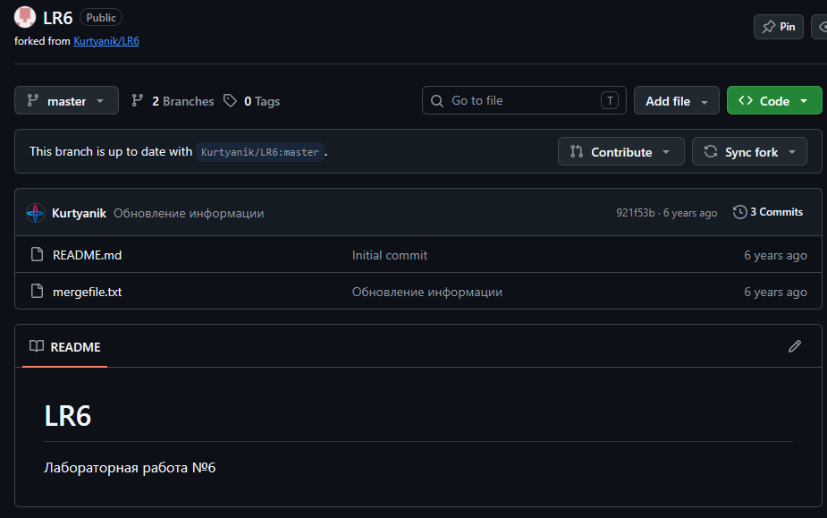
3. Установленный заранее Git
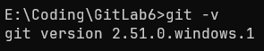
4. Настроенный заранее Git
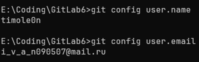
5. Клонирование репозитория
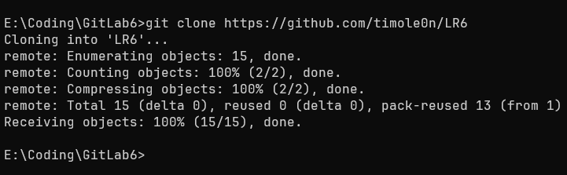
6. Добавление файла
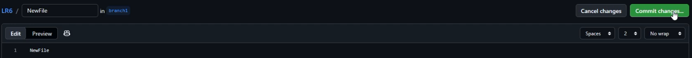
7. Стягивание изменений
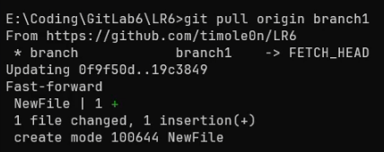
8. Просмотр изменений
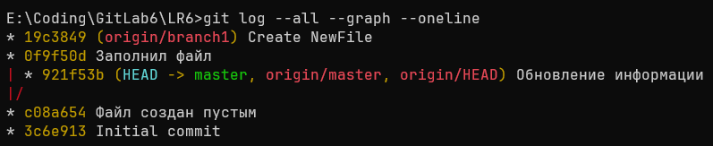
9. Merge в master, разрешение конфликта совмешением содержимого файла
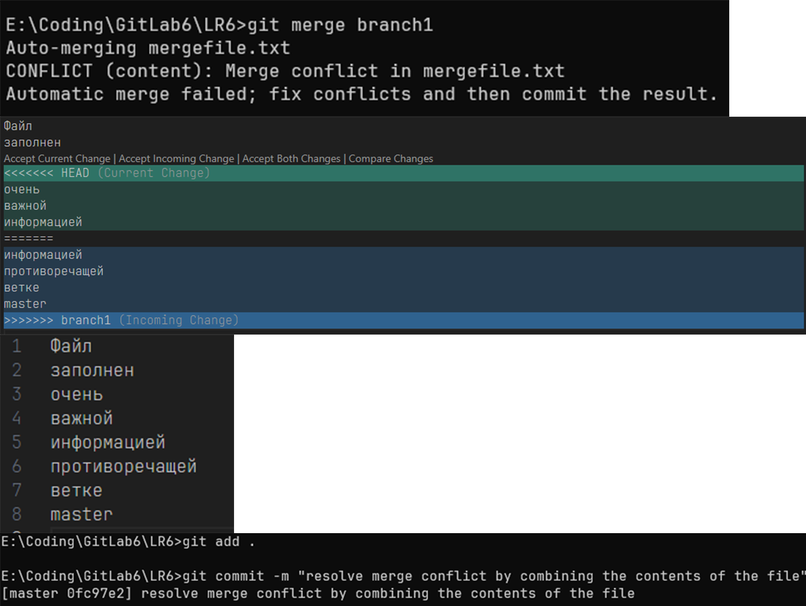
10. Удаление ветки branch1
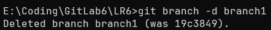
11. Добавление текста в mergefile.txt, коммит
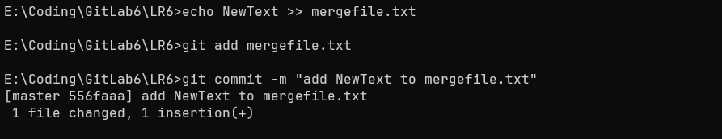
12. Создание файла CoolFile.txt, заполненного CoolText, коммит
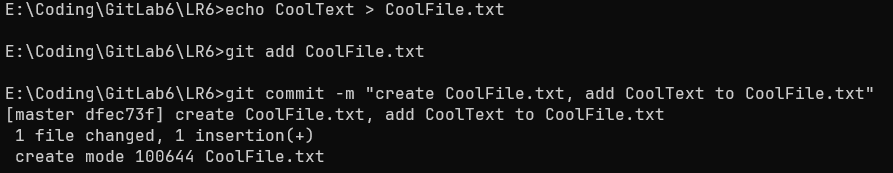
13. Откат коммита
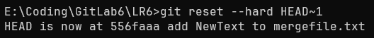
14. Создание ветки для отчёта
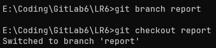

## Лог команд
```
git -v
git config user.name
git config user.email
git clone https://github.com/timole0n/LR6
git pull origin branch1
git log --all --graph --oneline
git merge branch1
git add .
git commit -m "resolve merge conflict by combining the contents of the file"
git branch -d branch1
echo NewText >> mergefile.txt
git add mergefile.txt
git commit -m "add NewText to mergefile.txt"
echo CoolText > CoolFile.txt
git add CoolFile.txt
git commit -m "create Coolfile.txt, add CoolText to CoolFile.txt
git reset --hard HEAD~1
git branch report
git checkout report
git add README.md
git commit -m "fill out README.md partially"
git log --pretty="%C(yellow)commit %h %nAuthor: %an %nDate: %cd %n%n%s%n" --date=short --graph
git add Screenshots
git add README.md
git commit "add Screenshots folder with files, finalyze README.md"
```
История операций в форматированном виде (сокращённый хэш + дата + имя автора + комментарий)
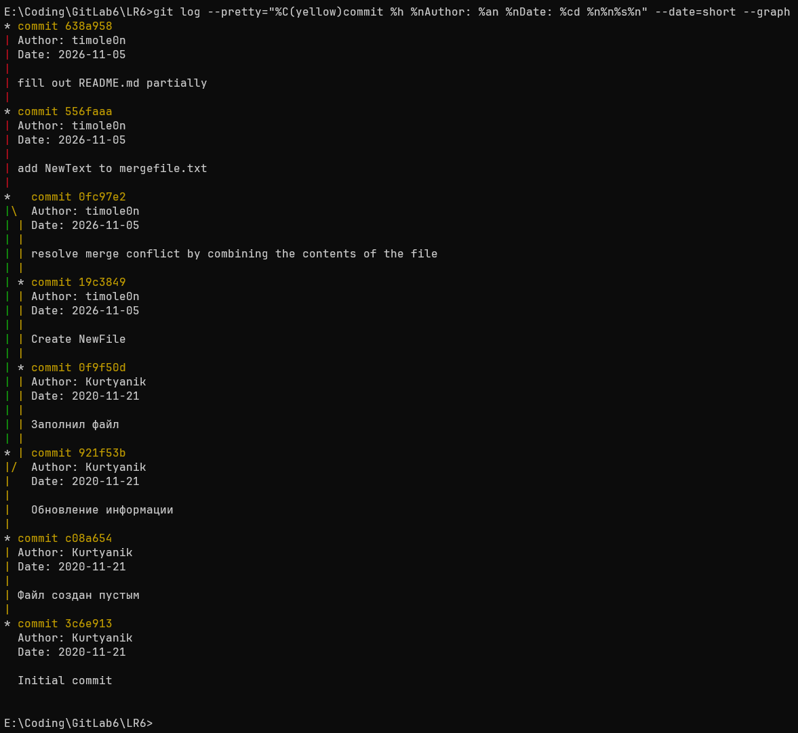